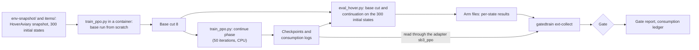

# gatedtrain recipe: SB3 PPO drone hover

This recipe teaches a simulated quadrotor to hover, and lets [gatedtrain](https://github.com/gatedtrain/gatedtrain)
decide whether the continued policy really is better than the one it continued from. stable-baselines3 PPO trains the
drone in gym-pybullet-drones (`HoverAviary`), CPU only, in two phases: a base run from scratch, then a continuation
from one of its cuts. gatedtrain gates the continuation against that base cut on 300 held-out initial states, by a rule
registered before training.

A recipe is a ready-made external run for gatedtrain: the training code with its locked environment, plus an
*adapter*, the small plugin through which gatedtrain reads the run's outputs. gatedtrain does not start the training;
you run it.

This is a prototype: the result below is one registered run, not a benchmark claim.

## How it works



`gatedtrain ext-launch` checks the run request and prints the container command; you run it. The steps, flags and
arm files are explained in gatedtrain's [External runs](https://gatedtrain.github.io/gatedtrain/external-runs/) guide.

## Result

One registered run, CPU only (0 GPU-hours; base run 23 s, continuation 85 s wall). The base run's cut 8 is the
baseline; the continuation runs 50 iterations to cut 58.

| | `hover_success` on 300 held-out initial states |
|---|---|
| Baseline (base cut 8) | 0.322 |
| Candidate (cut 58) | 0.992 |
| Gate | **PASS**: +0.669, 90% cluster-bootstrap interval [0.631, 0.705] |

`RESULT.md` has the full record: the metric (altitude within 0.06 m), power, overlap with training, the impact query
and the re-collection with this repository's adapter. The gate files are under `results/2026-11-12/`.

## Setup

```bash
pip install "gatedtrain @ git+https://github.com/gatedtrain/gatedtrain@v0.3.0"   # the framework, at the release this recipe was tested with
pip install -e .                      # the adapter, into the environment that runs gatedtrain
cd runtime && uv sync --frozen        # the training and evaluation environment (stable-baselines3, pybullet, torch CPU)
```

The adapter finds the runtime at `runtime/` of this checkout (or `GATEDTRAIN_RECIPE_SB3_PPO_DRONE_HOVER_RUNTIME`)
and reads the interpreter tree from `runtime/.venv/pyvenv.cfg`; the base runs' outputs go under the host's gatedtrain
output root (`<output_root>/sb3-ppo-drone-hover`). It locates `runtime/` from its own source tree, so an editable
install (`pip install -e .`) of a checkout works as is; a non-editable install (a wheel) has no `runtime/` next to the
package and needs `GATEDTRAIN_RECIPE_SB3_PPO_DRONE_HOVER_RUNTIME` set to the checkout's `runtime/` directory. `runtime/README.md` has the commands, mounts, profiles and the decisions behind
the metric.

**Checkpoints are pickles.** `train_ppo.py` (continue phase) and `eval_hover.py` load a cut's `model.zip` and
`vecnormalize.pkl` with stable-baselines3 (`PPO.load`, `VecNormalize.load`), which unpickle their contents: load
only checkpoints you produced yourself. The adapter only hashes these files and never opens them.

## Layout

| Path | What |
|---|---|
| `src/gatedtrain_recipe_sb3_ppo_drone_hover/` | the gatedtrain adapter `sb3_ppo` (`adapter.py`) and its registry rows (`rows.py`), registered through the `gatedtrain.adapters` entry point |
| `runtime/` | what runs in the container: `train_ppo.py`, `eval_hover.py`, the environment snapshot (`env-snapshot/`), the registered item set (`items/`), and its own `pyproject.toml` and `uv.lock` |
| `tests/` | the adapter's tests on fixture runs (no simulator needed) and gatedtrain's conformance check |
| `results/2026-11-12/` | the gate files of the published result (host paths redacted, see `RESULT.md`) |

## Tests

```bash
python -m unittest discover -s tests -t tests
```

Two tests compare this adapter with the TRL GRPO recipe's (`gatedtrain-recipe-trl-grpo-gsm8k`, adapter `trl_grpo`) and
skip when that recipe is not installed in the same environment.

Code comments, tests and the gate files under `results/` cite records of the framework's development: its review
rounds ("review round 6", "review 9 M1") and the maintainers' decisions of 2026-11-12. Those records are not
published.

## Data and licenses

Nothing third-party is redistributed here: the environment snapshot (`runtime/env-snapshot/`) and the item set
(`runtime/items/`) are generated by this recipe's scripts, and the dependencies below are installed from their
sources by `uv sync --frozen` (pinned in `runtime/uv.lock`).

| Component | Version / pin | License | Source |
|---|---|---|---|
| gym-pybullet-drones (`HoverAviary`, the CF2X model and its URDF assets) | 2.2.0, commit `15c426c85ac8e7a5db66d8b100f48858133357f6` | MIT (repository `LICENSE` at that commit, Copyright (c) 2020 Jacopo Panerati) | https://github.com/learnsyslab/gym-pybullet-drones |
| stable-baselines3 | 2.9.2 | MIT (Copyright (c) 2019 Antonin Raffin) | https://github.com/DLR-RM/stable-baselines3 |
| pybullet (Bullet Physics SDK) | 3.2.7 (built from the PyPI sdist) | zlib (files under `Extras` and `examples/ThirdPartyLibs` excepted, per its `LICENSE.txt`) | https://github.com/bulletphysics/bullet3 |
| gymnasium, torch (CPU build), numpy and the other locked packages | `runtime/uv.lock` | their own licenses | PyPI, download.pytorch.org |
| Container base image (no CUDA is used) | `docker.io/nvidia/cuda:13.0.3-devel-ubuntu24.04@sha256:b7ae301dea2c162444795462ce17a05f6a516e5a75944b57af5b88540a1a2266` | the license terms on the image's Docker Hub page (`nvidia/cuda`) and those of its packages | Docker Hub |

## License

Apache License 2.0, see `LICENSE` and `NOTICE`. No third-party material is redistributed; the table above gives the
licenses of the components the recipe installs.

Names of third-party projects and products are trademarks of their owners; this project is not affiliated with or
endorsed by them.
